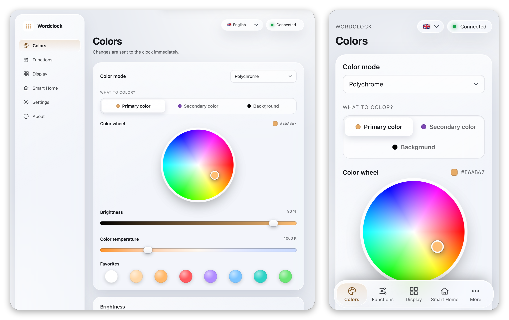
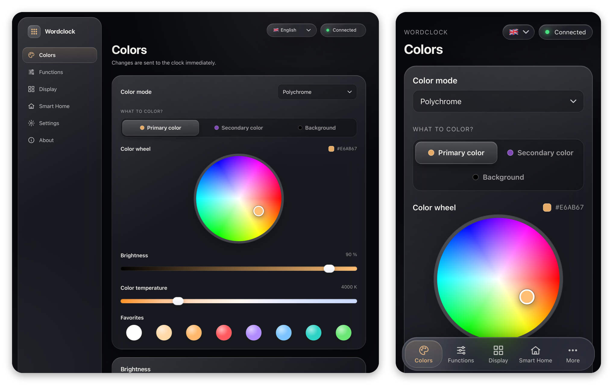
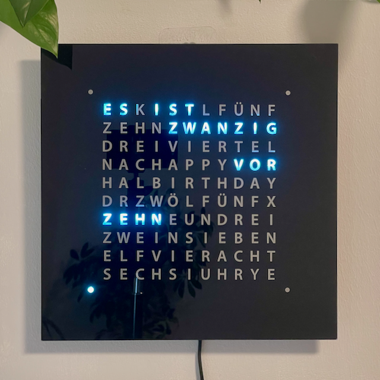

🇬🇧 English | [🇩🇪 Deutsch](README.md)

# ESP Wordclock

Firmware for a multilingual word clock with an ESP8266, ESP32 or ESP32-C3 and an LED strip (WS2812 or SK6812).

## Features

- **15 languages and dialects** with more than 30 front layouts
- **Web interface** in a liquid glass look with light and dark mode, a sidebar on desktop and a tab bar on phones, in seven languages
- **Colours:** colour wheel with brightness, colour temperature and favourites. Colour modes single colour, "Polychrome" (gradient from a primary to a secondary colour) and "Random per word". RGB and RGBW LEDs
- **Modes:** word clock, digital clock, scrolling text, symbols, colour, rainbow, fire, seconds and seconds frame
- **Transitions** between minutes, e.g. roll, fade, laser, matrix rain or fireworks
- **Brightness** by time of day or automatically via LDR or BH1750
- **Offline setup:** the setup portal sets the time (from your phone), colour, front layout and build type without any home network, an RTC keeps the time through power cuts
- **Home Assistant** via MQTT with auto-discovery
- **Updates** through the web interface without a cable

 
 
 
 

## Quick start

1. Flash the matching firmware from the [releases page](https://github.com/ESPWortuhr/Multilayout-ESP-Wordclock/releases) or build it yourself.
2. Connect to the WiFi network `Connect_to_Wordclock` and enter your home WiFi in the portal, or set time, colour and front there without WiFi.
3. Open the web interface at the IP address the clock shows.

## Documentation

Everything else is in the **[wiki](https://github.com/ESPWortuhr/Multilayout-ESP-Wordclock/wiki/English)**:

| | |
| :--- | :--- |
| [Installation](https://github.com/ESPWortuhr/Multilayout-ESP-Wordclock/wiki/Installation-EN) | Build it yourself, flash prebuilt firmware, updates, nightly builds |
| [Setup](https://github.com/ESPWortuhr/Multilayout-ESP-Wordclock/wiki/Setup-EN) | First start, offline setup through the portal, reset |
| [Hardware](https://github.com/ESPWortuhr/Multilayout-ESP-Wordclock/wiki/Hardware-EN) | Parts, build, wiring, pins, buttons, RTC, sensors |
| [Web interface](https://github.com/ESPWortuhr/Multilayout-ESP-Wordclock/wiki/Web-Interface-EN) | All functions and settings |
| [Front layouts](https://github.com/ESPWortuhr/Multilayout-ESP-Wordclock/wiki/Front-Layouts-EN) | Languages, layouts, build types |
| [Configuration](https://github.com/ESPWortuhr/Multilayout-ESP-Wordclock/wiki/Configuration-EN) | Settings in `include/Config.h` |
| [MQTT and Home Assistant](https://github.com/ESPWortuhr/Multilayout-ESP-Wordclock/wiki/MQTT-and-Home-Assistant-EN) | Topics, commands, entities |
| [Troubleshooting](https://github.com/ESPWortuhr/Multilayout-ESP-Wordclock/wiki/Troubleshooting-EN) | Common problems |
| [Development](https://github.com/ESPWortuhr/Multilayout-ESP-Wordclock/wiki/Development-EN) | Contributing, new front layouts |

Changes per version are listed in the [changelog](CHANGELOG.md).

## License

BSD-3: the software may be used, modified and redistributed freely as long as the copyright notice is kept. Details in [LICENSE](LICENSE).
