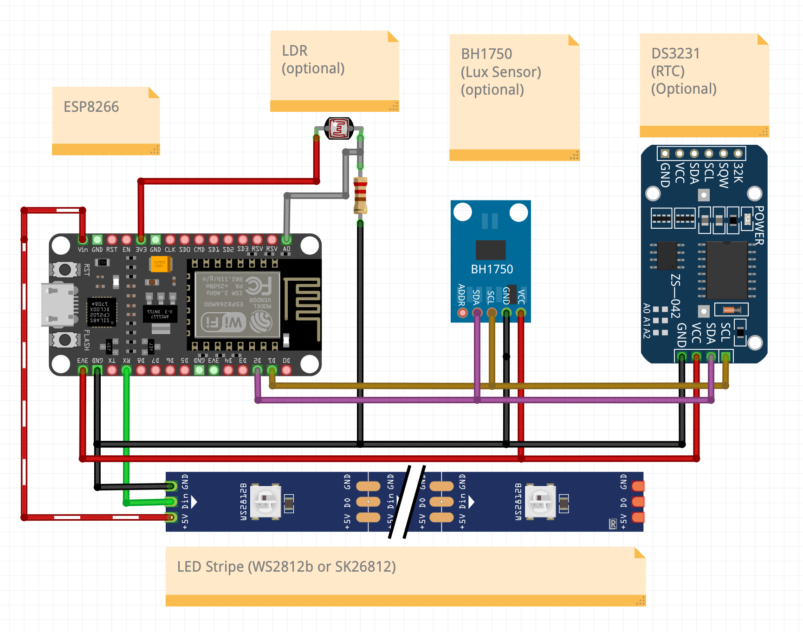

[](https://github.com/ESPWortuhr/Multilayout-ESP-Wordclock/actions/workflows/platformio.yml)
[](https://github.com/ESPWortuhr/Multilayout-ESP-Wordclock/actions/workflows/nightly.yml)
[](https://github.com/ESPWortuhr/Multilayout-ESP-Wordclock/actions/workflows/clang-format.yml)

[🇬🇧 English](README.en.md) | 🇩🇪 Deutsch

# ESP Wordclock


Firmware für eine mehrsprachige Wortuhr mit ESP8266, ESP32 oder ESP32-C3 und einem LED-Streifen (WS2812 oder SK6812).

## Funktionen

- **15 Sprachen und Dialekte** mit über 30 Frontlayouts, siehe [Unterstützte Sprachen](#unterstützte-sprachen)
- **Weboberfläche** im Liquid-Glass-Stil mit hellem und dunklem Modus, Seitenleiste am Desktop und Tab-Leiste am Smartphone, in sieben Sprachen
- **Farben:** Farbrad mit Helligkeit, Farbtemperatur und Favoriten. Farbmodi einfarbig, „Polychrom“ (Verlauf von Haupt- zu Zweitfarbe) und „Zufällig pro Wort“. RGB- und RGBW-LEDs
- **Modi:** Wortuhr, Digitaluhr, Lauftext, Symbole, Farbe, Regenbogen, Feuer, Sekundenanzeige und Sekundenrahmen
- **Übergänge** zwischen den Minuten, z. B. Rollen, Überblenden, Laser, Matrix-Regen oder Feuer
- **Helligkeit** nach Uhrzeit oder automatisch über LDR oder BH1750
- **Offline einstellen:** Über das Einrichtungsportal lassen sich Uhrzeit (vom Smartphone), Farbe, Frontlayout und Bauart ganz ohne Heimnetz einstellen, eine RTC hält die Zeit bei Stromausfall
- **Home Assistant** über MQTT mit Auto-Discovery, der Verbindungsstatus steht in der Weboberfläche
- **Updates** über die Weboberfläche ohne Kabel

## Inhaltsverzeichnis

- [Unterstützte Sprachen](#unterstützte-sprachen)
- [Betriebsmodi](#betriebsmodi)
- [Hardware](#hardware)
- [Installation](#installation)
- [Erster Start und Einrichtung](#erster-start-und-einrichtung)
  - [Offline einstellen über das Einrichtungsportal](#offline-einstellen-über-das-einrichtungsportal)
- [Konfiguration](#konfiguration)
- [MQTT und Home Assistant](#mqtt-und-home-assistant)
- [Mitwirken](#mitwirken)
- [Lizenz](#lizenz)

## Unterstützte Sprachen

Die Sprache ergibt sich aus dem Frontlayout. Alle Layouts sind in der Firmware enthalten und lassen sich in der Weboberfläche unter **Anzeige → Front** umschalten.

| | Sprache | Eigenname | Layouts (Zeilen × Spalten) |
|---|---|---|---|
| 🇩🇪 | Deutsch | Deutsch | 10 × 11 (Standard, Alternativ, Uhr, Nero, mrrioes), 11 × 11 (Standard, Version 2, panbachi), 13 × 13, 16 × 8, 16 × 18, 22 × 11 Wetter, 8 × 8, 8 × 8 Viertelstunden |
| 🇩🇪 | Bayerisch | Boarisch | 10 × 11 |
| 🇩🇪 | Schwäbisch | Schwäbisch | 10 × 11, 11 × 11 |
| 🇬🇧 | Englisch | English | 10 × 11, 11 × 12, 8 × 8 |
| 🇳🇱 | Niederländisch | Nederlands | 10 × 11 |
| 🇫🇷 | Französisch | Français | 10 × 11 |
| 🇪🇸 | Spanisch | Español | 10 × 11, 8 × 8 Viertelstunden |
| 🇮🇹 | Italienisch | Italiano | 10 × 11 |
| 🇨🇭 | Schweizerdeutsch | Schwiizerdütsch | 10 × 11, 10 × 11 Version 2, 10 × 11 Züridütsch (Zürich) |
| 🇸🇪 | Schwedisch | Svenska | 10 × 11 |
| 🇭🇺 | Ungarisch | Magyar | 10 × 10 |
| 🇷🇴 | Rumänisch | Română | 10 × 11 |
| 🇷🇺 | Russisch | Русский | 10 × 11 |
| 🇹🇷 | Türkisch | Türkçe | 10 × 11 |
| 🇧🇩 | Bengalisch | বাংলা | 9 × 8 |

## Betriebsmodi

<p align="center">
 
 
 
 

</p>

## Hardware

- Board mit ESP8266, ESP8285, ESP32 oder ESP32-C3, z. B. NodeMCU oder Wemos D1 Mini
- LED-Streifen WS2812B (RGB) oder SK6812 (RGBW)
- Netzteil 5 V. Leuchten viele Buchstaben weiß, zieht die Matrix mehrere Ampere, empfohlen sind 3 bis 5 A
- Optional: RTC (DS3231 oder DS1307), Lichtsensor (LDR mit 10-kΩ-Widerstand oder BH1750), Pegelwandler wie 74AHCT125 für ein sauberes 5-V-Datensignal



Netzteil +5 V und GND gehen an den ESP und an den LED-Streifen, der Daten-Pin des ESP an DIN der ersten LED. Die Streifen werden meist im Zick-Zack verklebt: DOUT einer Zeile geht an DIN der nächsten Zeile auf derselben Seite.

**Aufbau von vorne nach hinten:** Frontplatte mit den Buchstaben, Diffusor (milchige Folie oder Architektenpapier), Lichtgitter, das jede LED von ihren Nachbarn trennt, und Trägerplatte mit den LED-Streifen.

| Front | Matrix | LED-Streifen | Hinweis |
| :--- | :--- | :--- | :--- |
| 30 × 30 cm | 25 × 25 cm | 60 LEDs/m | Standardmaß, jede LED wird genutzt |
| 40 × 40 cm | 35 × 35 cm | 74 LEDs/m | Jede zweite LED einer Reihe bleibt ungenutzt |
| 50 × 50 cm | 50 × 50 cm | 30 LEDs/m | Der LED-Abstand passt direkt zum Raster |

## Installation

USB-Boards wie NodeMCU oder Wemos D1 Mini brauchen meist einen Treiber für **CH340** oder **CP210x**. Zum Flashen ein Datenkabel verwenden, kein reines Ladekabel.

### Selbst kompilieren

Nur so lässt sich die Uhr über `include/Config.h` an Layout, Sprache und Hardware anpassen. Benötigt werden [PlatformIO](https://platformio.org/install), [Node.js](https://www.nodejs.org/) und [Git](https://git-scm.com).

```sh
git clone https://github.com/ESPWortuhr/Multilayout-ESP-Wordclock.git
cd Multilayout-ESP-Wordclock
pio run -e ESP8266 -t upload   # oder -e ESP32 / -e ESP32C3
```

- **Windows:** PlatformIO IDE für VS Code installieren, das Projekt über **Clone Git Project** öffnen und unter **Project Tasks → General → Upload** flashen.
- **macOS:** `brew install platformio node`
- **Linux:** PlatformIO mit dem [Installationsskript](https://docs.platformio.org/en/latest/core/installation/methods/installer-script.html) installieren, dazu `sudo apt install npm git`. Für den Zugriff auf den seriellen Port den Benutzer der Gruppe `dialout` hinzufügen.

Der erste Build dauert einige Minuten, weil PlatformIO alle Bibliotheken lädt.

### Fertige Firmware

Auf der [Releases-Seite](https://github.com/ESPWortuhr/Multilayout-ESP-Wordclock/releases) liegt pro Chip eine Datei, z. B. `ESP8266_V5.0.0.bin`, dazu `SHA256SUMS`. Sie enthält die Standard-Konfiguration: deutsches Layout `Ger10x11Alternative`, GRB-LEDs, RTC DS3231. Wer etwas anderes braucht, kompiliert selbst.

- **Update über WLAN:** `http://<IP-der-Uhr>:81/update` öffnen (Port 81), die `.bin` hochladen. Die Einstellungen bleiben erhalten.
- **Serielles Flashen** mit `esptool` (`pip install esptool`):
  ```sh
  esptool.py --chip esp8266 --port /dev/ttyUSB0 write_flash 0x0 ESP8266_V5.0.0.bin
  esptool.py --chip esp32 --port /dev/ttyUSB0 write_flash 0x10000 ESP32_V5.0.0.bin
  ```
- **Im Browser** mit [esptool-js](https://espressif.github.io/esptool-js/) oder [esp.huhn.me](https://esp.huhn.me/), gleiche Offsets. Das geht nur in Chrome, Edge oder Opera.

Beim ESP32 und ESP32-C3 schreibt der Offset `0x10000` nur die Anwendung. Ein komplett leerer Chip braucht zusätzlich Bootloader und Partitionstabelle. Dafür einmal mit `pio run -t upload` flashen.

**Nightly-Builds:** Für jeden Stand von `main` liegen unter [Actions → Nightly Firmware](https://github.com/ESPWortuhr/Multilayout-ESP-Wordclock/actions/workflows/nightly.yml) fertige Dateien für alle drei Chips. Für den Download ist ein GitHub-Login nötig, die Dateien werden nach 14 Tagen gelöscht. Es sind ungetestete Entwicklungsstände.

## Erster Start und Einrichtung

1. Die Uhr öffnet das WLAN `Connect_to_Wordclock`. Damit verbinden.
2. Das Einrichtungsportal öffnet sich von selbst, sonst `http://192.168.4.1` aufrufen.
3. Heim-WLAN eintragen. Die Uhr startet neu und ist danach unter ihrer IP-Adresse erreichbar.

### Offline einstellen über das Einrichtungsportal

Die Uhr lässt sich ganz ohne Heimnetz in Betrieb nehmen und grundlegend einstellen, nur mit dem Smartphone:

1. Mit dem WLAN `Connect_to_Wordclock` verbinden. Die Uhr übernimmt sofort die Uhrzeit des Smartphones und stellt eine vorhandene RTC gleich mit.
2. Im Portal **Clock** öffnen. Dort lassen sich einstellen:
   - Vordergrundfarbe
   - Uhrvariante (Frontlayout)
   - die sechs Layout-Schalter
   - Bauart der Matrix
   - die Uhrzeit von Hand, falls die automatische Übernahme nicht klappt
3. Mit **Save settings** speichern. Eine geänderte Matrixgröße gilt erst nach einem Neustart.
4. **Continue without WiFi** verlässt das Portal, die Uhr zeigt jetzt Farbe und Uhrzeit an.

- Ohne RTC geht die Uhrzeit bei einem Stromausfall verloren und muss über das Portal neu übernommen werden.
- Mit RTC schließt sich das Portal nach 120 Sekunden ohne Bedienung von selbst, die Uhr läuft mit der Zeit der RTC.

### Portal, RTC und I2C

**Portal erneut öffnen:** Die Uhr dreimal kurz hintereinander vom Strom trennen, jeweils bevor sie fertig gestartet ist. Beim **sechsten** Start in Folge werden alle Einstellungen außer den WLAN-Daten zurückgesetzt.

**RTC HW-111 (DS1307):** In `include/Config.h` `RTC_Type` auf `RTC_DS1307` setzen und selbst kompilieren. Mit einer normalen CR2032 statt einer LIR2032 muss die Ladeschaltung entfernt werden: D1, R4, R5 und R6 auslöten und die Pads von R6 brücken ([Arduino-Forum](https://forum.arduino.cc/t/tiny-rtc-i2c-module-issue/173162/22)).

**I2C-Pins** für RTC und BH1750 werden in der Weboberfläche unter **Einstellungen → Hardware-Pins** eingetragen. **I2C-Adressen suchen** zeigt, was am Bus hängt: DS3231 und DS1307 unter `0x68`, BH1750 unter `0x23` oder `0x5C`.

## Konfiguration

Die Standardwerte stehen in `include/Config.h`. Fast alles lässt sich später in der Weboberfläche ändern.

| Einstellung | Bedeutung | Standard |
| :--- | :--- | :--- |
| `DEFAULT_LAYOUT` | Frontlayout und damit Sprache | `Ger10x11Alternative` |
| `DEFAULT_LEDTYPE` | Farbreihenfolge des LED-Streifens | `Grb` |
| `WHITE_LEDTYPE` | Farbtemperatur der weißen LED bei RGBW | `NeutralWhite` |
| `DEFAULT_HUE` / `DEFAULT_BRIGHTNESS` | Farbton (0–360) und Helligkeit in % beim ersten Start | `120` / `100` |
| `DEFAULT_BUILDTYPE` | Bauart der Matrix | `Normal` |
| `LED_PIN` | GPIO für die LED-Daten | `3` (RX) |
| `SDA_PIN_…` / `SCL_PIN_…` | I2C-Pins, `255` = aus | ESP8266: `D2` / `D1` |
| `RTC_Type` | RTC-Modul | `RTC_DS3231` |
| `AUTOBRIGHT_LDR_…` | Widerstandswerte für den LDR-Spannungsteiler | `15`, `1000`, `10` |
| `MINUTE_…` | Art der Minutenanzeige | `MINUTE_LED4x` |
| `MANUAL_WIFI_SETTINGS`, `WIFI_SSID`, `WIFI_PASSWORD` | WLAN fest einkompilieren | aus |
| `CP_PROTECTED`, `CP_SSID`, `CP_PASSWORD` | Einrichtungsportal | offen, `Connect_to_Wordclock` |
| `WEB_PROTECTED`, `WEB_USER`, `WEB_PASSWORD` | Passwort für den Update-Port 81 | aus |
| `REVERSE_MINUTE_DIR`, `MIRROR_FRONT_…`, `FLIP_HORIZONTAL_VERTICAL`, `EXTRA_LED_PER_ROW`, `MEANDER_ROWS` | Verdrahtung der Matrix | Zick-Zack, nicht gespiegelt |

## MQTT und Home Assistant

Die Uhr spricht das **JSON-Light-Schema** von Home Assistant. `<TOPIC>` ist das Basis-Topic aus der Weboberfläche, z. B. `ESPWordclock`.

| Topic | Inhalt |
| :--- | :--- |
| `<TOPIC>/cmd` | Befehle an die Uhr |
| `<TOPIC>/status` | Zustand nach jeder Änderung |
| `<TOPIC>/availability` | `online` / `offline` |

| Feld | Werte |
| :--- | :--- |
| `state` | `"ON"`, `"OFF"` |
| `brightness` | `0`–`255` |
| `color` | `{"h": 0–360, "s": 0–100}`, setzt die Vordergrundfarbe |
| `effect` | `Wordclock`, `Seconds`, `Digitalclock`, `Scrollingtext`, `Rainbowcycle`, `Rainbow`, `Fire`, `Color`, `Symbol` |
| `scrolling_text` | Text für `Scrollingtext` |

```json
{ "state": "ON", "brightness": 255, "color": { "h": 0, "s": 100 } }
{ "effect": "Scrollingtext", "scrolling_text": "Hallo Welt!" }
```

**Auto-Discovery:** Beim Verbinden, nach einem Neustart von Home Assistant oder über **MQTT Discovery** in der Weboberfläche meldet die Uhr jede Entität einzeln unter `homeassistant/<Typ>/<MAC>…/config`. Home Assistant fasst sie zu einem Gerät zusammen:

- Licht mit Ein/Aus, Helligkeit, Farbe und allen Effekten
- Lauftext, Nachricht (zeigt einen Text als Lauftext), Effektgeschwindigkeit, automatische Helligkeit
- Auswahl für Übergang, Übergangsfarbe und Übergangsdauer
- Diagnose: Helligkeit in Lux, LED-Verstärkung, WLAN-Signal, IP-Adresse, Laufzeit

Systeme, die das Home-Assistant-Format nachbilden (z. B. openHAB), finden die Uhr ebenfalls. Änderungen aus Home Assistant oder über die Tasten erscheinen sofort in jeder offenen Weboberfläche.

## Mitwirken

Pull Requests für neue Sprachen, Frontlayouts oder Fehlerkorrekturen sind willkommen.

- **Formatierung:** `clang-format -i $(git ls-files '*.h' '*.hpp' '*.cpp' '*.ino')`. Die CI prüft mit clang-format 11.
- **Build:** `pio run` baut alle drei Umgebungen, genau wie die CI. Die Workflows [PlatformIO CI](.github/workflows/platformio.yml), [clang-format](.github/workflows/clang-format.yml) und [Nightly Firmware](.github/workflows/nightly.yml) müssen grün sein.
- **Neues Frontlayout:**
  1. Die Layout-Datei als `.hpp` nach `include/WordClockTypes/` legen. Sie wird automatisch eingebunden.
  2. Das Layout in `CLOCK_TYPES_LIST` in [include/WordClockState.h](include/WordClockState.h) mit der nächsten freien ID eintragen, z. B. `X(Ger10x11Alternative, 12, _de10x11Alternative, "de-10-11-alt")`.
  3. Den Anzeigenamen unter dem i18n-Schlüssel in `webpage/language/*.js` (Abschnitt `view.front`) ergänzen. Die Auswahlliste der Weboberfläche entsteht automatisch.

## Lizenz

BSD-3: Die Software darf frei verwendet, verändert und weitergegeben werden, solange der Copyright-Hinweis erhalten bleibt. Details in [LICENSE](LICENSE).
